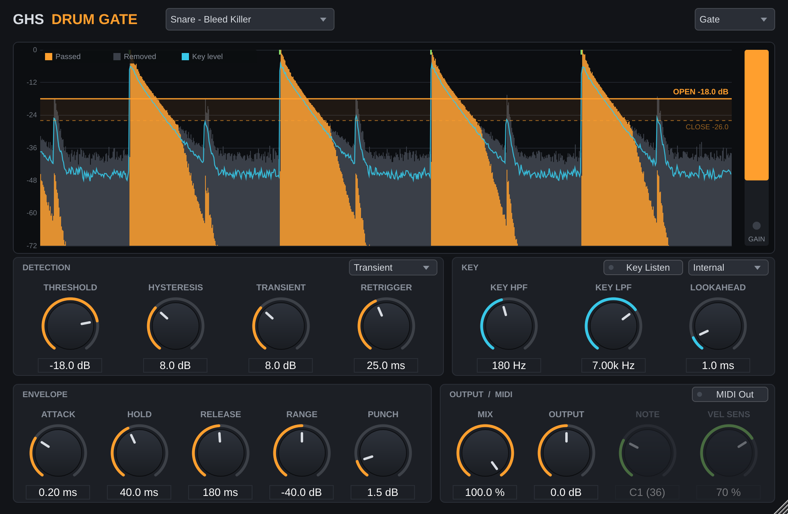

# GHS Drum Gate

A drum gate (AU + VST3) built for close-mic'd kit: it keeps the hit and kills the bleed,
including the problems a plain gate has with drums: chatter on decaying tails, flams that
fire twice, hi-hat spill that is louder than a quiet snare ghost note, and clipped attacks.



## Controls

**Detection**
| Control | What it does |
|---|---|
| Detect: Peak / RMS / Transient | How the key level is measured. **Transient** only opens on a *sudden* rise (fast envelope jumping above a slow one), so slow-building bleed, cymbal wash and ringing toms can cross the threshold without opening the gate. |
| Threshold | Opening level (-80 to 0 dB). You can also drag up/down on the display. |
| Hysteresis | The gate closes this many dB *below* the threshold (dashed line). Stops chatter on a decaying hit. |
| Transient | (Transient mode) how many dB the attack has to jump to count as a hit. Raise it to reject more bleed. |
| Retrigger | Minimum time between openings. Stops flams, double hits and drag ruffs from re-triggering the gate or MIDI. |

**Key** (the detector's sidechain)
| Control | What it does |
|---|---|
| Key HPF / Key LPF | Band-limit what the detector hears, e.g. HPF 180 Hz and LPF 7 kHz on snare so the kick and hats don't open it. Audio isn't filtered, only the detector. |
| Lookahead | 0-10 ms. Delays the audio so the gate is already open when the transient arrives. Reported to the host as latency. |
| Internal / Sidechain | Key from the track itself or from the plugin's sidechain input. |
| Key Listen | Hear the filtered key signal to dial in HPF/LPF. |

**Envelope**
| Control | What it does |
|---|---|
| Attack | Opening time (0.01-50 ms, linear ramp). |
| Hold | How long the gate stays open after the level falls below the close threshold. |
| Release | Time to close fully (exponential, so the tail fades naturally). |
| Range | How far it closes: -inf (fully shut) up to 0 dB. Use -10 to -20 dB to just lower the bleed. |
| Punch | Up to +12 dB of extra level right at the opening, decaying over ~25 ms. Adds snap to each hit. |

**Output / MIDI**
| Control | What it does |
|---|---|
| Gate / Duck | Duck inverts the gate: the signal is turned *down* by Range while the key is active (e.g. duck room mics on every kick using the sidechain). |
| Mix | Dry/wet for parallel gating: blend a gated version under the natural track. |
| Output | Output trim, ±24 dB. |
| MIDI Out, Note, Vel Sens | Sends a note on every hit (note-off when the gate closes) for drum replacement or layering a sample. Velocity follows how hard the hit was; Vel Sens 0% gives a fixed 127. |

**Display:** grey is the audio the gate removed, orange is what it let through, the cyan line is
the detector (key) level, green ticks mark each detected hit, and the bar on the right is the
current gain.

**Factory presets:** Init, Kick - Tight, Snare - Bleed Killer, Toms - Natural Ring, Hi-Hat - Clean,
Room - Duck on Kick, Kick - MIDI Trigger.

## Building

It builds along with GHS FX Companion: `./rebuild.sh` at the repo root pulls, builds both plugins,
clears the AU cache and runs `auval` on both. The AU shows up in Logic under
**Audio Units → Grand Healing Studio → GHS Drum Gate**.

To build only the gate:

```
cmake -S DrumGate -B build-gate -DCMAKE_BUILD_TYPE=Release
cmake --build build-gate --target GHSDrumGate_AU GHSDrumGate_VST3
```

Sidechain in Logic: use the plugin header's **Side Chain** menu to pick the source track, then set
the gate's key to **Sidechain**. If no sidechain is routed, the gate says so and uses its own input.

## Tests

`Tests/GateDSPTest.cpp` checks the gate engine's behaviour (bleed removal, the hit passing
intact, lookahead timing, range, retrigger guard, hysteresis, duck mode, transient rejection
of a slow swell, key filtering, block-size independence):

```
cmake --build build-gate --target GHSDrumGateDSPTest && ./build-gate/GHSDrumGateDSPTest
```
