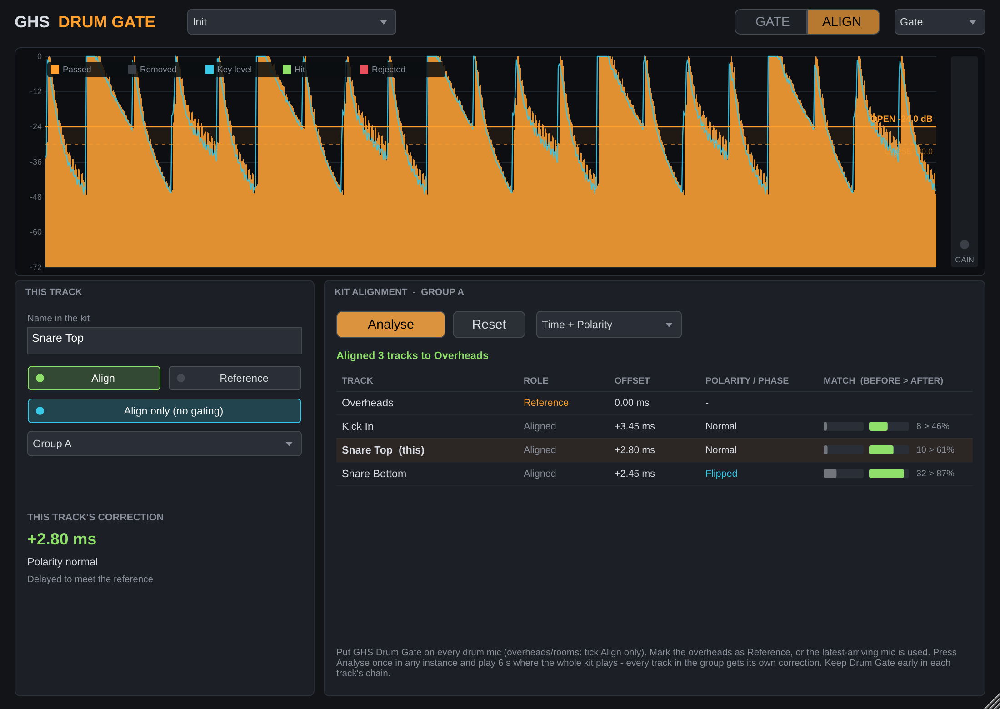

# GHS Drum Gate

A drum gate (AU + VST3) built for close-mic'd kit: it keeps the hit and kills the bleed,
including the problems a plain gate has with drums: chatter on decaying tails, flams that
fire twice, kick spill on the snare mic that's louder than a snare ghost note, clipped attacks,
and the "silence after noise" pumping of a broadband gate.

It combines the two ideas behind dedicated drum gates:
- **Judging hits by sound, not just level** (Hit Match): learn what the drum sounds like, and
  what the spill sounds like, and the gate opens only for real hits. Hits get their own
  adaptive decay, levelling and clipping.
- **Two-band gating**: close the highs harder than the lows, so the drum's body rings out
  naturally while the hiss and cymbal wash are removed.


## Controls

**Detection**
| Control | What it does |
|---|---|
| Detect: Peak / RMS / Transient | How the key level is measured. **Transient** only opens on a *sudden* rise (fast envelope jumping above a slow one), so slow-building bleed, cymbal wash and ringing toms can cross the threshold without opening the gate. |
| Threshold | Opening level (-80 to 0 dB). You can also drag up/down on the display. |
| Hysteresis | The gate closes this many dB *below* the threshold (dashed line). Stops chatter on a decaying hit. |
| Transient | (Transient mode) how many dB the attack has to jump to count as a hit. Raise it to reject more bleed. |
| Retrigger | Minimum time between openings. Stops flams, double hits and drag ruffs from re-triggering the gate or MIDI. |

**Hit Match** (timbre-based hit detection)
| Control | What it does |
|---|---|
| Learn Hits | While lit, every hit that crosses the threshold is captured as the reference sound. Play or loop a few bars where only the drum you want is playing (e.g. a snare fill), then switch it off. |
| Learn Spill | Same, for the sound you want gone (e.g. a bar with just kick spill on the snare mic). Hits heard while learning spill are rejected. |
| Clear | Forgets both. |
| Match | Turns Hit Match on. Each candidate hit's first 3 ms is fingerprinted (its energy across 7 bands, level-independent) and compared with what was learned: hits that don't sound like the drum, or sound more like the spill, are rejected (red ticks on the display) and the gate stays shut. Quiet ghost notes that sound right still open it. |
| Tolerance | How close a hit has to sound to the learned hits to pass (dB of fingerprint difference). Lower = stricter. The status line shows the last hit's distance. |

Learned profiles are saved with your session. Hit Match decides at each opening; if spill arrives while the gate is still open from a real hit, it doesn't close it early.

**Key** (the detector's sidechain)
| Control | What it does |
|---|---|
| Key HPF / Key LPF | Band-limit what the detector hears, e.g. HPF 180 Hz and LPF 7 kHz on snare so the kick and hats don't open it. Audio isn't filtered, only the detector. |
| Lookahead | 0-10 ms. Delays the audio so the gate is already open when the transient arrives. Reported to the host as latency. |
| Internal / Sidechain / MIDI / Align Only | Key from the track itself, from the plugin's sidechain input, or from MIDI notes (e.g. a trigger track or a drum MIDI part). In MIDI mode each note-on opens the gate for Hold, then Release, with the note's velocity as the hit strength. Align Only turns the gate off (see Align below). |
| Trig Note | In MIDI mode: which note triggers the gate (Any, or a specific note). |
| Key Listen | Hear the filtered key signal to dial in HPF/LPF. |

**Envelope**
| Control | What it does |
|---|---|
| Attack | Opening time (0.01-50 ms, linear ramp). |
| Hold | How long the gate stays open after the level falls below the close threshold. |
| Release | Time to close fully (exponential, so the tail fades naturally). |
| Adaptive | Scales Release by how hard each hit was: at 100%, the hardest hits get 2x the release and the softest get half. Big hits ring out, soft hits don't drag bleed along. |
| Punch | Up to +12 dB of extra level right at the opening, decaying over ~25 ms. Adds snap to each hit. |

**Bands**
| Control | What it does |
|---|---|
| Range / Low | How far the gate closes: -inf (fully shut) up to 0 dB. With Two-Band on, this is the low band. |
| Two-Band | Splits the gating at the crossover (4th-order Linkwitz-Riley, so it sums flat when open). |
| High Range | How far the high band closes. E.g. Low -12 dB / High -60 dB keeps a tom's body ringing while the cymbal wash on that mic disappears. |
| Crossover | Where low and high split (150 Hz - 8 kHz). |

**Hit Dynamics** (applied per hit, Gate mode only)
| Control | What it does |
|---|---|
| Leveller | Pulls each hit's peak toward Target by this much (0-100%), up to ±18 dB. Evens out a performance while keeping some of the contrast between accents and ghost notes. |
| Target | The level the leveller aims for. |
| Hit Clip | Soft-clips every hit by this many dB below its own (levelled) peak, so loud and quiet hits get the same amount of clipping instead of only the loud ones. |

**Output / MIDI**
| Control | What it does |
|---|---|
| Gate / Duck | Duck inverts the gate: the signal is turned *down* by Range while the key is active (e.g. duck room mics on every kick using the sidechain). |
| Mix | Dry/wet for parallel gating: blend a gated version under the natural track. |
| Output | Output trim, ±24 dB. |
| MIDI Out, Note, Vel Sens | Sends a note on every hit (note-off when the gate closes) for drum replacement or layering a sample. Velocity follows how hard the hit was; Vel Sens 0% gives a fixed 127. |

**Display:** grey is the audio the gate removed, orange is what it let through, the cyan line is
the detector (key) level, green ticks mark each hit the gate opened for, red ticks mark hits Hit
Match rejected, and the bar on the right is the current gain.

**Latency:** Lookahead plus a fixed 3 ms analysis window (used to measure each hit before
deciding), reported to the host so it's compensated automatically.

**Factory presets:** Init, Kick - Tight, Snare - Bleed Killer, Toms - Natural Ring, Hi-Hat - Clean,
Snare - Two-Band Natural, Snare - Punch & Clip, Overheads - Align Only, Room - Duck on Kick,
Kick - MIDI Trigger.

## Align: time, polarity and phase across the whole kit



Every mic on a kit hears the same hits at slightly different times (the overheads are a metre
or more further away than the close mics), sometimes inverted (snare bottom, kick in vs out),
and sometimes rotated in phase. Lining them up gives a tighter low end and punchier shells
before any EQ. The **ALIGN** tab does it for every instance at once.

**Setting it up**
1. Put GHS Drum Gate on every drum mic, early in each track's chain (before anything that
   adds latency or changes the timing).
2. On the overheads (and rooms), tick **Align only (no gating)**, which is Key Source = Align
   Only, and mark them **Reference**. If no track is marked, the latest-arriving mic is used,
   which is normally the overheads.
3. Press **Analyse** in any instance, then play about 6 s of the song where the whole kit is playing.
   Every instance in the group records the same stretch of the timeline. Each mic is then
   analysed against the reference and gets its own correction, and Align switches on.
4. Done. The table in every instance shows each track's offset, whether it was flipped or rotated,
   and how much better it lines up with the reference (before > after).

**Controls**
| Control | What it does |
|---|---|
| Name in the kit | How this track is listed in every instance's table. Defaults to the host's track name. |
| Align | Applies this track's correction. Every aligned instance adds the same fixed 10 ms (plus a few samples) of latency, which the host compensates, so tracks can be moved earlier as well as later. |
| Reference | The track everything else is lined up to. |
| Align only (no gating) | Passes the audio straight through (no gate, no dynamics), just aligned. For overheads and rooms. |
| Group A-D | Instances only align with others in the same group, e.g. for two kits in one session. |
| Time + Polarity / Time + Phase | Polarity only flips (0 or 180 degrees). Phase also rotates by any angle through a matched allpass pair on every aligned track, for mics whose phase relationship isn't a clean flip. |
| Analyse / Reset | Records and analyses the group, or clears every correction in it. |

**How it works:** for each mic, a whitened cross-correlation (GCC-PHAT) against the reference
finds the arrival time. It focuses on the moments that mic's own drum is playing, so a kick
mic isn't lined up to its snare bleed. The time is refined to a fraction of a sample and played
back through a 32-tap windowed-sinc fractional delay. The best polarity, or phase rotation, is
then found in closed form after the time shift. Corrections are saved with the session.

**Limits:** ±10 ms of difference between any mic and the reference (about 3.4 m). Mics further
away are shown as out of range and left as they are. Instances find each other inside the
DAW's process, so a host that runs each plugin in its own sandboxed process would show each
instance alone. Logic runs AU v2 plugins like this one in-process.

## Building

It builds along with GHS FX Companion: `./rebuild.sh` at the repo root pulls, builds both plugins,
clears the AU cache and runs `auval` on both. The AU shows up in Logic under
**Audio Units → Grand Healing Studio → GHS Drum Gate**.

To build only the gate:

```
cmake -S DrumGate -B build-gate -DCMAKE_BUILD_TYPE=Release
cmake --build build-gate --target GHSDrumGate_AU GHSDrumGate_VST3
```

Sidechain in Logic: use the plugin header's **Side Chain** menu to pick the source track, then set
the gate's key to **Sidechain**. If no sidechain is routed, the gate says so and uses its own input.

## Tests

`Tests/GateDSPTest.cpp` checks the gate engine's behaviour (bleed removal, the hit passing
intact, lookahead timing, range, retrigger guard, hysteresis, duck mode, transient rejection
of a slow swell, key filtering, block-size independence, two-band split, adaptive decay,
leveller, per-hit clipper, Hit Match learning/rejection, MIDI triggering):

`Tests/AlignDSPTest.cpp` checks the alignment maths: the Hilbert pair, fractional delay,
sub-sample lag estimation in both directions, out-of-range detection, polarity, phase rotation,
a realistic kit with bleed (kick, snare top and flipped snare bottom against the overheads, in
both modes), and the realtime aligner.

`Tests/AlignE2ETest.cpp` runs four real plugin instances on a synthetic kit with known mic
distances and a fake host playhead. It presses Analyse through the shared registry, then checks
that every instance's output really lines up with the overheads afterwards.

```
cmake --build build-gate --target GHSDrumGateDSPTest GHSDrumGateAlignTest GHSDrumGateAlignE2E
cd build-gate && ctest --output-on-failure
```
